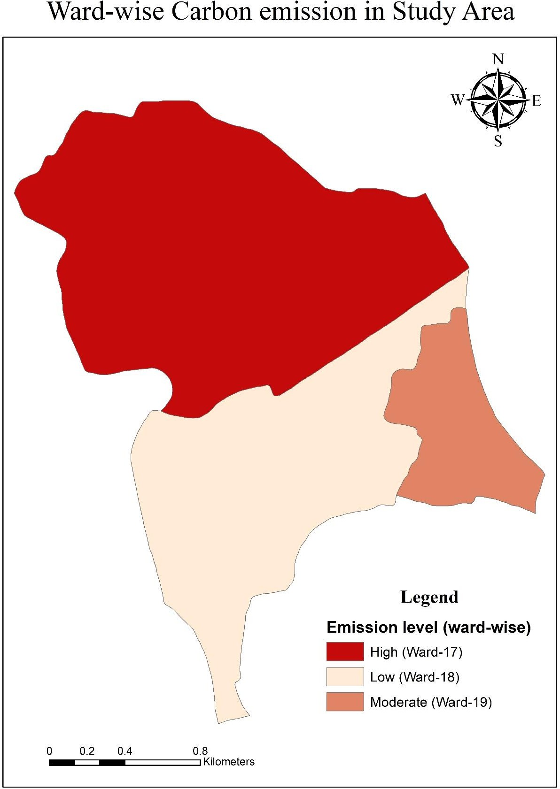
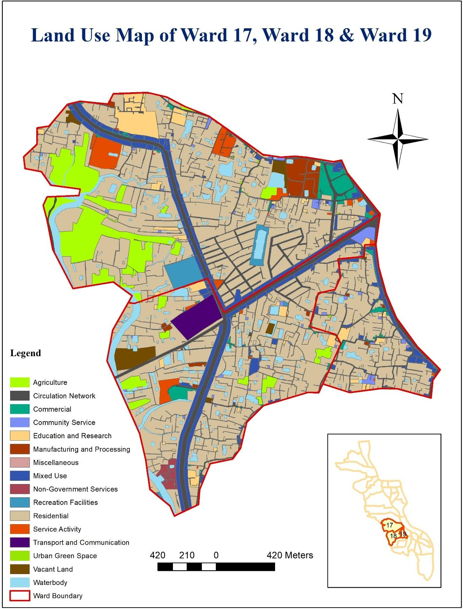
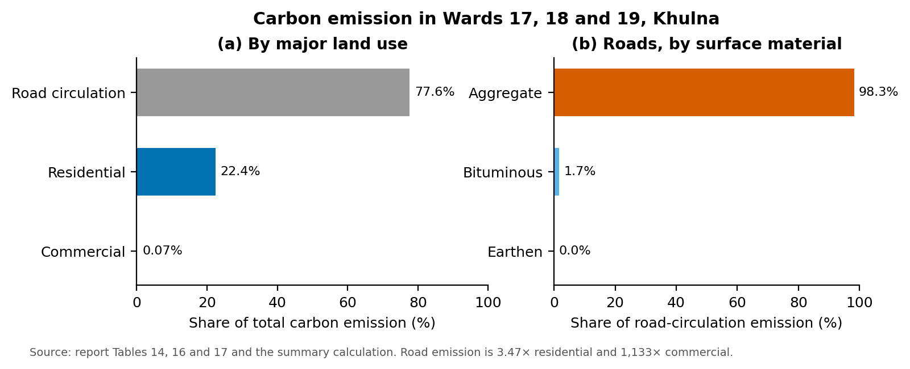
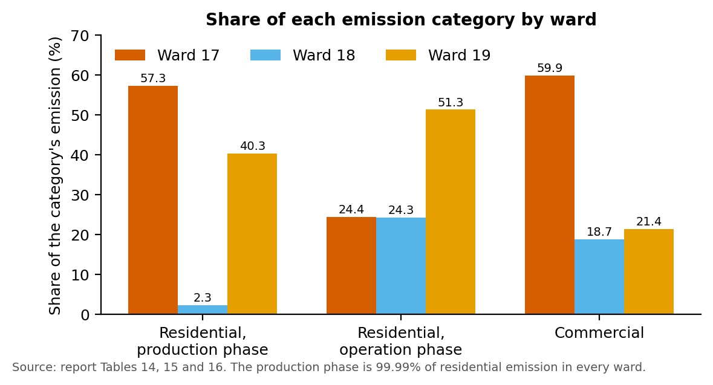
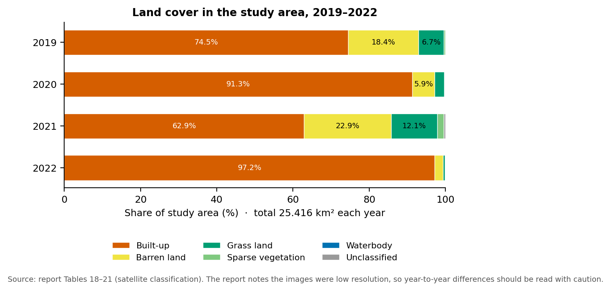

# Carbon Footprint Mapping of Wards 17, 18 and 19, Khulna City

**URP 4142 Environmental Planning and Management Studio, Dept. of Urban and Regional Planning, KUET** 
## Summary

This project profiles the carbon footprint of three wards of Khulna City to judge their global warming potential. We surveyed 108 samples across the main land uses, converted fuels, electricity, water, construction materials and road surfaces into CO₂ equivalents with DEFRA 2022 factors, and compared emissions by ward, land use and life-cycle phase. Road circulation is the largest source, about 78% of the total. Ward 17 has the highest settlement emissions. Almost all residential emission comes from the production (construction) phase rather than daily operation. Satellite land-cover maps for 2019–2022 show built-up land replacing barren land and vegetation.



## Study area

Wards 17, 18 and 19 of Khulna City Corporation (Sonadanga Thana), in the south-west of the city. Residential use covers 60.15% of the area, circulation network 11.53%, mixed use 6.48% and waterbodies 5.49%.



## Data

| Data | Source |
|---|---|
| Household and commercial energy, fuel, water, food and construction data | Questionnaire survey, 108 samples |
| Road surface materials and waterbodies | On-site survey and land use map |
| Emission factors (kg CO₂e per unit) | UK DEFRA 2022 greenhouse gas conversion factors |
| Ward population (46,880 · 25,890 · 40,650) | Population census |
| Land cover, 2019–2022 | Satellite images |

## Method

1. **Data needs by land use.** For residential, circulation and mixed/commercial land use we listed the emission sources to collect: gaseous, liquid and solid fuels, biomass, electricity, water supply, construction materials, waste and food.
2. **Sampling.** A sample of 384 was calculated (95% confidence, 5% margin of error, p = 0.5). It was split by land-use share and then reduced to a final 108 samples.

   | Land use | Share of area | Final sample |
   |---|---|---|
   | Residential | 60.15% | 36 |
   | Circulation network | 11.53% | 44 |
   | Commercial and mixed use | 8.15% | 18 |
   | Waterbody | 5.49% | 10 |

3. **Conversion.** Each quantity was multiplied by its DEFRA CO₂e factor and the results summed in Excel.
4. **Roads.** The area of each road surface (aggregate, bituminous, earthen) was multiplied by its material factor.
5. **Analysis.** We compared emissions by ward, by land use and, for housing, by life-cycle phase (production vs operation). We mapped emission levels by ward and classified land cover for 2019–2022.

## Results



- **Roads dominate.** Road circulation produces 77.6% of the total, 3.47 times the residential total and about 1,133 times the commercial total. Aggregate roads cover less area than bituminous roads but, by the report's figures, emit about 56 times more.
- **Ward 17 emits most.** It has 57.3% of residential and 59.9% of commercial emission. Ward 19 has 40.3% of residential emission, and ward 18 only 2.3%.
- **Construction outweighs use.** The production phase is more than 99.98% of residential emission in every ward. Operation-phase emission is highest in ward 19 (51.3%).



- **Land cover.** Built-up land rose from 74.5% (2019) to 97.2% (2022) of the classified area, while barren land and grass land shrank.



- **Per person.** The study compared the footprint per resident with standard ranges (2.67–7.14 t CO₂e a year is optimal, 7.14–9.82 t is high) and found it high.

## Tools

Microsoft Excel · GIS (maps and land-cover classification) · Python (pandas, matplotlib) for the redrawn charts

## Repository contents

```
images/   original maps (unchanged, renamed) and redrawn charts
viz/      make_figures.py and data/ (values copied from the report tables)
```

## Contact

Chinmoy Ghosh Shuvo · Open to collaboration and knowledge sharing. Feel free to reach out on [LinkedIn](https://www.linkedin.com/in/chinmoyghosh034).
